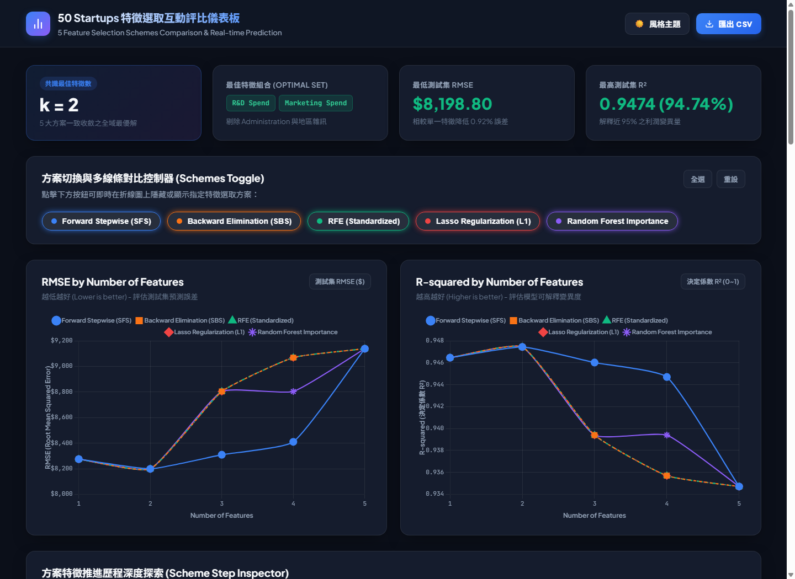

# 50 Startups: 多元線性迴歸與 5 大特徵選取方案評比

本專案基於 **CRISP-DM** 方法論與 **Scikit-learn** 機器學習框架，針對經典的 **50 Startups** 資料集進行多元線性迴歸建模，系統性實作並對比 **5 大特徵選取方案（5 Feature Selection Schemes）**，並打造出高質感的現代化互動式評比儀表板。

---

## 🌐 線上展示與成果截圖

> 🚀 **GitHub Pages 線上互動儀表板**：[https://nchu-mei.github.io/1151014-DIC2/](https://nchu-mei.github.io/1151014-DIC2/)



---

## 專案亮點

1. **CRISP-DM 完整生命週期 (`main.py`)**：
   - 商業理解與探索性資料分析（EDA）
   - One-Hot Encoding 虛擬變數處理與避免虛擬變數陷阱
   - 訓練集/測試集分割與 5-Fold 交叉驗證
   - 殘差診斷與真實值 vs 預測值視覺化
   - 導出訓練完畢之 Pipeline 模型 (`startup_profit_model.pkl`)

2. **5 大特徵選取方案評比 (`feature_selection_comparison.py`)**：
   - **方案 1: 前向逐步選取 (Forward Stepwise Selection, SFS)**（包裝法基準）
   - **方案 2: 後向淘汰法 (Backward Elimination, SBS)**（包裝法）
   - **方案 3: 遞迴特徵消除 (Recursive Feature Elimination, RFE)**（標準化敏感度消除）
   - **方案 4: Lasso (L1) 稀疏正則化路徑選取**（線性嵌入法）
   - **方案 5: 隨機森林特徵重要性 (Random Forest Feature Importance)**（非線性樹模型嵌入法）
   - 自動繪製並輸出 300 DPI 雙折線比較圖 (`feature_selection_comparison.png`)
   - 導出完整 25 筆實驗數據報表 (`feature_selection_results.csv`)

3. **現代化互動式評比儀表板 (`index.html`)**：
   - 整合 Chart.js 雙子圖（RMSE & $R^2$ 隨特徵數量變化）
   - 支援 5 種方案多線條動態過濾與點擊切換
   - 特徵推進歷程探索器（Step Inspector & Slider）
   - 新創公司利潤即時試算模擬器（Live Profit Predictor）
   - 亮色 / 暗色主題（Dark / Light Theme）自由切換

---

## 核心結論

經過 5 種不同流派的特徵選取方法評比，所有演算法**一致高度收斂**至相同的全域最優解：
- **最佳特徵數量**：$k = 2$
- **最佳特徵組合**：`['R&D Spend', 'Marketing Spend']`
- **最佳測試集表現**：
  - **RMSE**：`$8,198.80`（達到最低預測誤差）
  - **R²**：`0.9474`（解釋 94.74% 利潤變異）
- 當特徵數增加至 3~5 個時，加入 `Administration` 或地區虛擬變數反而因雜訊與多重共線性導致測試集泛化誤差上升（過度擬合）。

---

## 安裝與快速開始

### 1. 安裝相依套件
```bash
pip install -r requirements.txt
```

### 2. 執行迴歸主程式
```bash
python main.py
```

### 3. 執行 5 大特徵選取方案評比
```bash
python feature_selection_comparison.py
```

### 4. 開啟互動式網頁
- **線上造訪**：[https://nchu-mei.github.io/1151014-DIC2/](https://nchu-mei.github.io/1151014-DIC2/)
- **本地開啟**：直接在瀏覽器中開啟 `index.html`，或啟動本地伺服器：
  ```bash
  python -m http.server 8080
  # 瀏覽器造訪 http://localhost:8080/index.html
  ```

---

## 檔案結構
```text
├── 50_Startups.csv                    # 原始資料集
├── main.py                            # CRISP-DM 迴歸主程式
├── feature_selection_comparison.py    # 5 大特徵選取評比腳本
├── feature_selection_comparison.png   # 5 方案雙折線對比圖 (300 DPI)
├── feature_selection_results.csv      # 評比數據報表
├── webpage_screenshot.png             # 互動式儀表板完整畫面截圖
├── actual_vs_predicted.png            # 預測值 vs 真實值散佈圖
├── residuals_vs_predicted.png         # 殘差分佈診斷圖
├── startup_profit_model.pkl           # 訓練完成之迴歸 Pipeline 模型
├── index.html                         # 互動式儀表板前端
├── style.css                          # 現代化毛玻璃樣式表
├── app.js                             # 儀表板前端互動邏輯
├── requirements.txt                   # Python 相依清單
├── .gitignore                         # Git 忽略設定
└── README.md                          # 專案說明文件
```
